<p align="center">
  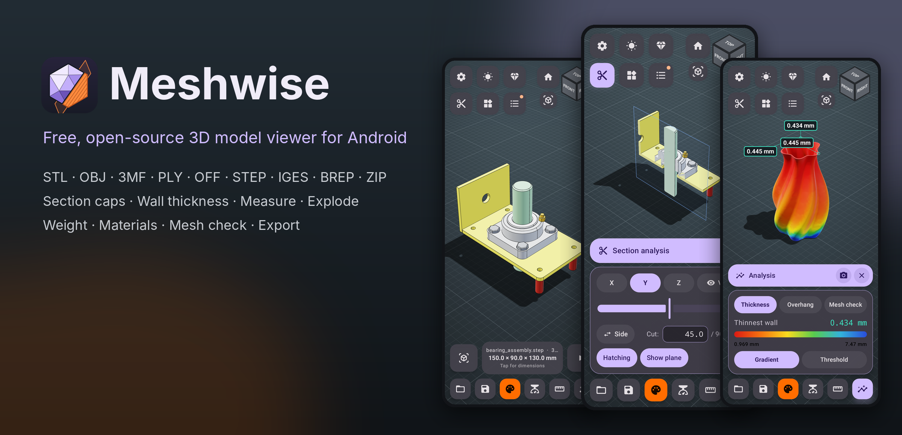
</p>

<p align="center">
  <a href="../../releases/latest"></a>
  
  
  <a href="LICENSE"></a>
  <a href="https://doesthings.github.io/donate/"></a>
</p>

**Meshwise** is a fast 3D model viewer for Android. Open 3D printing and CAD files on your
phone and check them before you print: section cuts, measurements, wall thickness, exploded
assemblies, weight estimates and more.

- **Free and open source** (MIT). No ads, no account, no paywall.
- **STEP and IGES included**, through the Open CASCADE kernel.
- **Private.** No tracking, and your files never leave your phone. The only network use is an
  optional update check that is off until you turn it on.

> **Honest note:** Meshwise is vibe coded: I built it with a lot of help from an AI coding
> assistant. It works well enough, it has automated tests, and I just wanted to share a good
> free tool with whoever needs one. If something breaks, please
> [open an issue](../../issues/new/choose).

## Download

Get the latest APK from the [**Releases**](../../releases/latest) page and open it on your
phone. You may need to allow installs from your browser or file manager.

| APK | For |
|---|---|
| `Meshwise-x.y.z-arm64-v8a.apk` | Nearly every phone and tablet from the last 8 years. **Pick this if unsure.** |
| `Meshwise-x.y.z-armeabi-v7a.apk` | Older 32-bit ARM devices |
| `Meshwise-x.y.z-x86_64.apk` | Chromebooks and emulators |
| `Meshwise-x.y.z-universal.apk` | Any device (largest download) |

Meshwise needs Android 8.0 (API 26) or newer with OpenGL ES 3.0. Almost every device in use
today has both.

Every release is signed with the same Meshwise certificate, so a new version installs over the
old one. If you turn on the optional update check, the app tells you when a new version is out
(see [Privacy](#privacy)). To check a download, run `apksigner verify --print-certs` on it. The SHA-256 must be
`69:FE:7F:DD:77:48:C2:FA:DD:BE:F4:3C:66:BC:8B:EC:F7:19:AA:AC:CD:D3:40:DE:42:F7:F3:EB:31:4B:4D:11`.

## Screenshots

<table>
  <tr>
    <td align="center">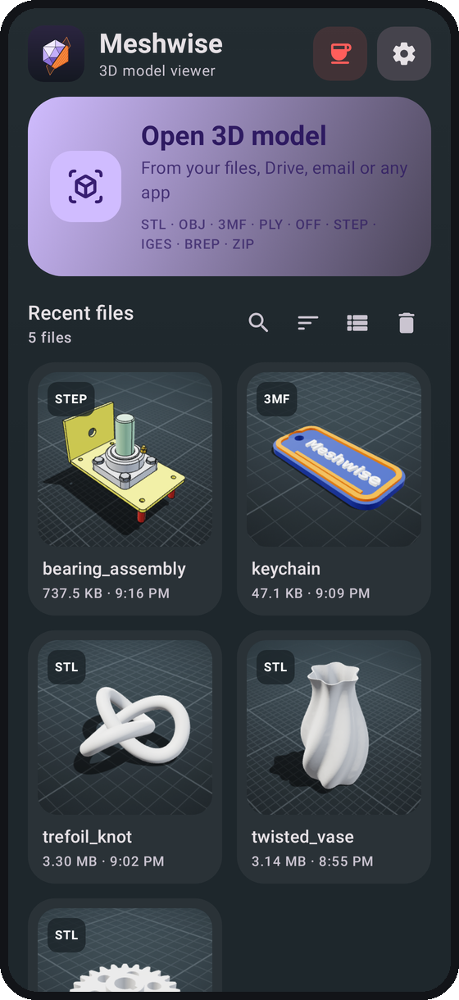<br><sub><b>Home</b>: recent files with thumbnails, library, samples</sub></td>
    <td align="center">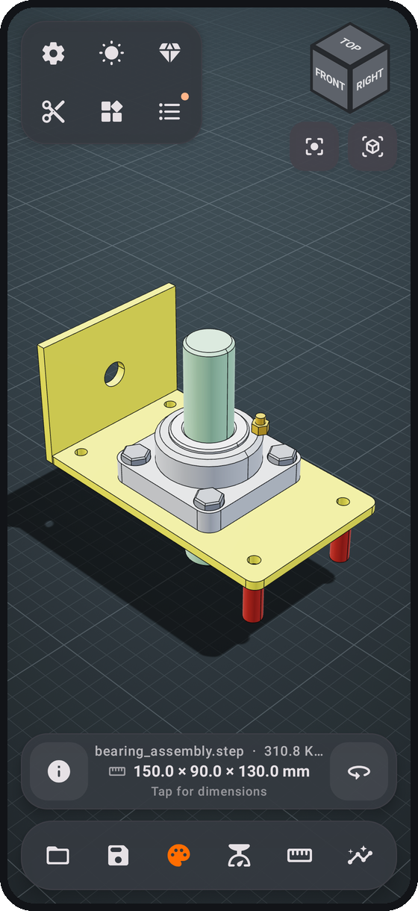<br><sub><b>Viewer</b>: STEP assembly with real part colors</sub></td>
    <td align="center">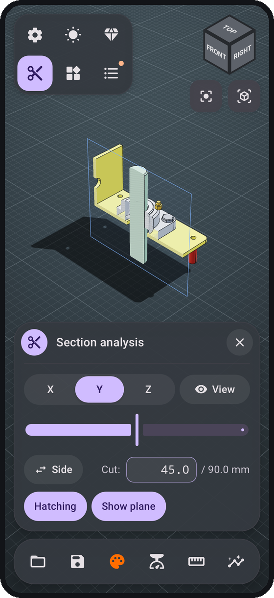<br><sub><b>Section analysis</b>: hatched caps, live plane</sub></td>
  </tr>
  <tr>
    <td align="center">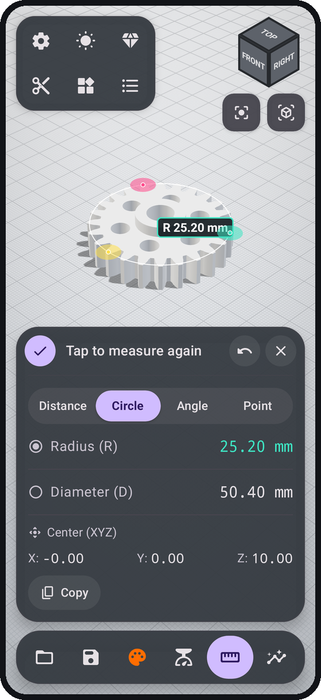<br><sub><b>Measure</b>: circle through 3 points, R / D / center</sub></td>
    <td align="center">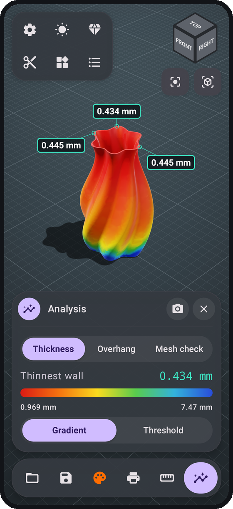<br><sub><b>Wall thickness</b>: heat map, thinnest-wall callouts</sub></td>
    <td align="center">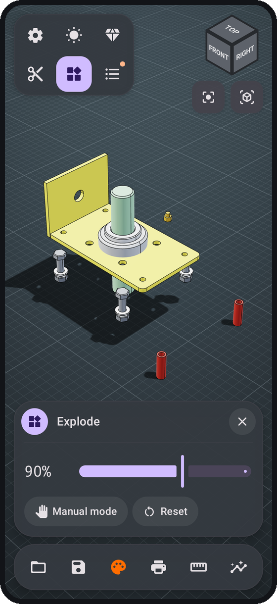<br><sub><b>Explode</b>: automatic or manual with gizmo</sub></td>
  </tr>
  <tr>
    <td align="center">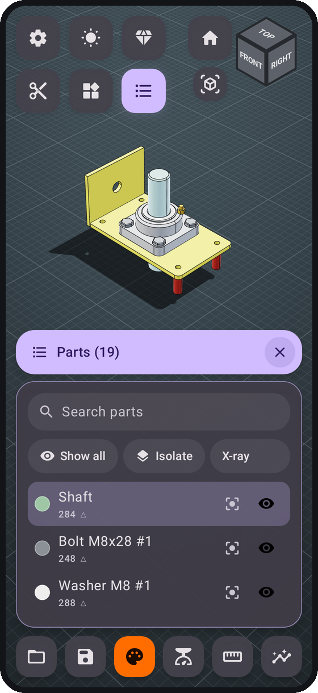<br><sub><b>Parts</b>: search, isolate, x-ray, focus</sub></td>
    <td align="center">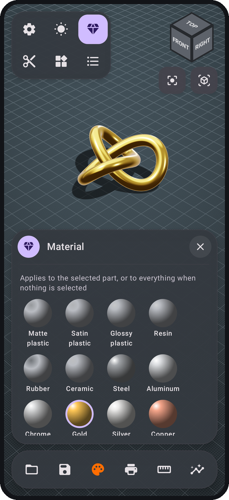<br><sub><b>Materials</b>: plastics, metals, resin, ceramic</sub></td>
    <td align="center">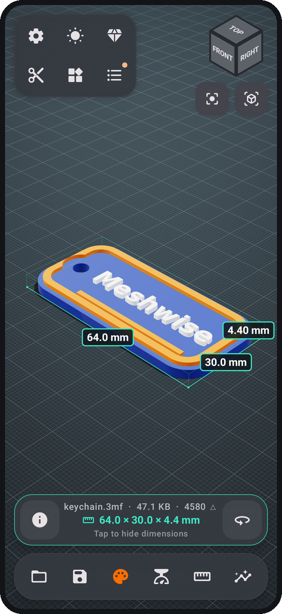<br><sub><b>Dimensions</b>: bounding box overlay</sub></td>
  </tr>
  <tr>
    <td align="center">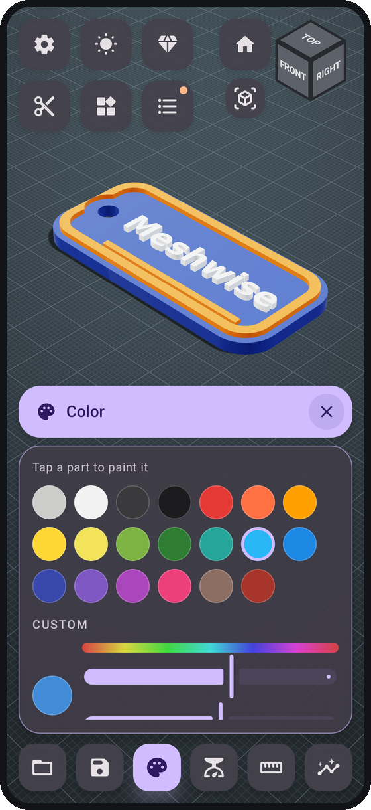<br><sub><b>Color</b>: paint parts, custom colors</sub></td>
    <td align="center">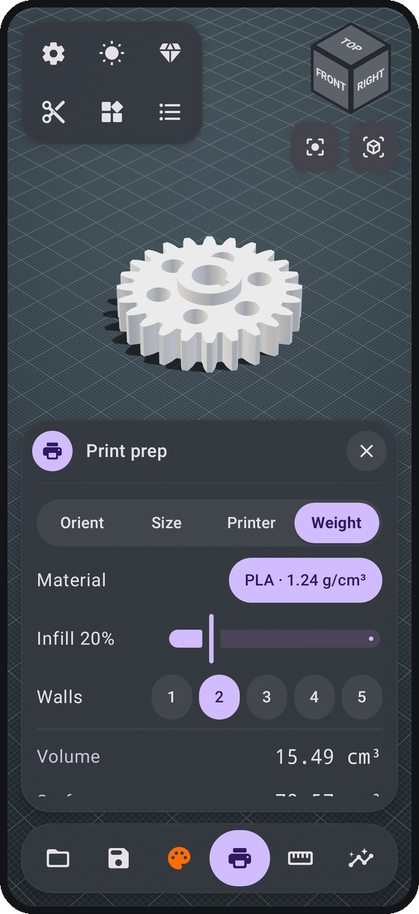<br><sub><b>Weight</b>: filament, infill, walls, cost</sub></td>
    <td align="center">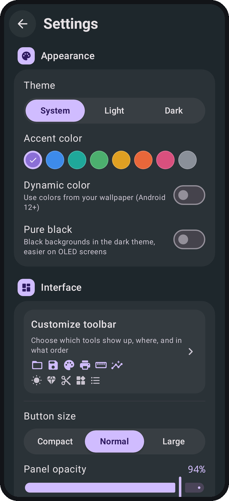<br><sub><b>Settings</b>: themes, accent colors, controls, units</sub></td>
  </tr>
  <tr>
    <td align="center">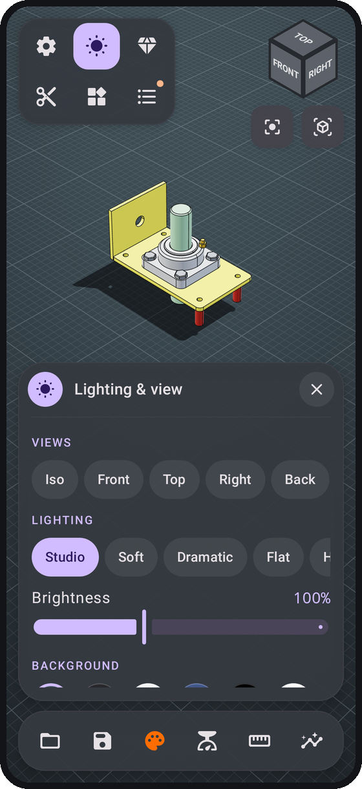<br><sub><b>View</b>: standard views, lighting, backgrounds, field of view</sub></td>
    <td align="center">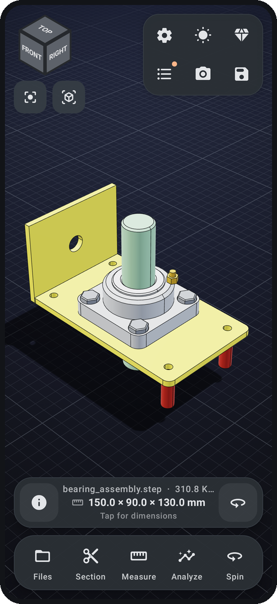<br><sub><b>Your layout</b>: accent color, labels, left-handed mode</sub></td>
    <td align="center">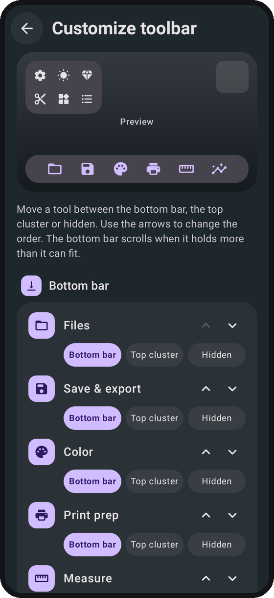<br><sub><b>Customize toolbar</b>: pick, place and order the tools</sub></td>
  </tr>
</table>

## Features

**Open almost anything**
- STL (binary and ASCII), OBJ with MTL colors, 3MF (multiple objects, colors), PLY (binary and ASCII, vertex colors), OFF
- STEP, IGES and BREP CAD files with assembly structure, part names and colors (Open CASCADE)
- ZIP archives: every model inside is loaded and laid out side by side
- Open files from other apps with "Open with" or "Share" (file managers, cloud drives, email, chat apps)
- Recent files with thumbnails, an on-device library, and five sample models to try

**A fast, clear viewer**
- Orbit, pan and pinch-zoom with inertia; zoom toward your fingers; double-tap to focus on a point
- View cube, standard views, perspective or orthographic projection with an adjustable field of view, turntable mode
- Physically based materials (matte, satin, glossy, resin, rubber, ceramic, steel, aluminium, chrome, gold, silver, copper, brass, titanium), studio, soft, dramatic, flat and headlight lighting, soft shadows on a grid floor
- Eleven background presets or your own two-color gradient
- Smooth shading that keeps sharp edges crisp, feature edges, wireframe and axes

**Inspect and analyze**
- **Section analysis**: cut along X, Y or Z, flip the side, type an exact cut value, solid hatched caps
- **Measure**: point-to-point distance (with ΔX/ΔY/ΔZ), circle through three points (radius, diameter, center), angle, point coordinates and normals; copy results to the clipboard
- **Dimensions**: tap the info bar to show the X/Y/Z size of the model
- **Wall thickness**: gradient or threshold heat map and callouts at the thinnest walls
- **Overhang** analysis with an adjustable angle, and a **mesh check** for open and non-manifold edges, flipped normals, degenerate faces and shell count
- **Weight estimate**: PLA, PETG, ABS, ASA, TPU, nylon, resin and more, with infill, wall count, filament length and cost

**Work with assemblies**
- Parts list with search, show/hide, isolate, x-ray the rest, and focus
- Explode slider, plus a manual mode with a 3-axis drag gizmo, per-part hide and undo
- Paint parts individually or all at once, and assign materials per part

**Make it yours**
- Light, dark or system theme, eight accent colors or Material You, and a pure black mode for OLED screens
- Customize the toolbar: choose which tools sit in the bottom bar, which in the top cluster and which are hidden, and set their order
- Button size, panel opacity, button labels, a left-handed layout, and switches for the view cube and the info bar
- Opening view, model color and material for files without colors, selection highlight color
- Controls: rotation speed, inverted drag, what a double tap does, turntable speed and direction, haptic feedback
- Measurement units and decimal places, reopen the last model on start, and one tap to reset everything

**Save and share**
- Save projects (`.meshwise`: camera, colors, materials, explode layout, section) and reopen them later
- Export STL, OBJ (with part names), 3MF (with names and colors) or high-resolution PNG snapshots, optionally with a transparent background
- Share any export straight to another app

## Performance

The C++ core memory-maps the file, parses it without copies, welds vertices with a hash of
exact positions, and builds normals, topology and the BVH on all cores. These numbers come from
the bundled `fsv_bench` tool on a **4-core x86_64 cloud VM**, not a phone. Expect a phone to be
slower; real phone timings are welcome in an issue.

| Model | Size | Triangles | Load + mesh processing | Topology | BVH (picking) | Wall thickness |
|---|---:|---:|---:|---:|---:|---:|
| Twisted vase (sample) | 3.1 MB | 66 k | 13 ms | 5 ms | 12 ms | 30 ms |
| Trefoil knot, dense | 97.7 MB | 2.05 M | 0.41 s | 0.17 s | 0.57 s | 1.3 s |

Only loading has to finish before the first frame. Topology, BVH and analysis run in the
background while you already orbit the model. The renderer packs each vertex into 24 bytes
(position, 10-bit normal, color, part ID) and only redraws when something changes, so the GPU
and battery rest when you are not touching the screen.

## How it works

```
┌──────────────────────── Kotlin / Jetpack Compose ────────────────────────┐
│  HomeScreen · ViewerScreen · panels · overlays (labels, gizmo, cube)     │
│  ViewerViewModel ── Engine (JNI facade) ── GLSurfaceView (on demand)     │
└───────────────┬────────────────────────────────────┬─────────────────────┘
                │ JNI                                │ Messenger IPC
┌───────────────▼──────────────────┐  ┌──────────────▼─────────────────────┐
│ libmeshwise.so (C++17)           │  │ :cad process · libmeshwise_cad.so  │
│ loaders: STL OBJ 3MF PLY OFF ZIP │  │ Open CASCADE 7.8.1: STEP/IGES/BREP │
│ weld · normals · topology · BVH  │  │ XCAF names/colors · BRepMesh       │
│ analysis · exporters · camera    │  │ → FSM mesh, cached per file        │
│ GLES 3 renderer (PBR, shadows,   │  └────────────────────────────────────┘
│ stencil section caps, x-ray)     │
└──────────────────────────────────┘
```

- **`native/core`**: loaders, mesh processing, BVH, analysis, exporters, camera and the
  OpenGL ES 3 renderer. Platform-independent; the same code runs in the headless desktop
  renderer and the unit tests.
- **`native/jni`**: the JNI bridge (`libmeshwise.so`).
- **`native/cad`**: Open CASCADE import (`libmeshwise_cad.so`). It runs in its own process, so a
  broken CAD file can't crash the viewer. Results are cached as compact FSM meshes, so a STEP
  file opens much faster the second time.
- **`app/`**: the Kotlin app (Compose Material 3 UI, view model, file handling, projects).

## Building

You need JDK 17+, Android SDK 36, NDK `28.2.13676358` and CMake 3.31.6 (Android Studio can
install them), plus `git` and `ninja` for the CAD kernel.

```bash
git clone https://github.com/doesthings/Meshwise.git
cd Meshwise

# Optional but recommended: build Open CASCADE for STEP/IGES/BREP (once, about 20-40 min per ABI).
# Without it the app still builds, but it can't open CAD formats.
for abi in arm64-v8a armeabi-v7a x86_64; do scripts/build-occt-android.sh $abi; done

./gradlew assembleDebug          # app/build/outputs/apk/debug/
./gradlew assembleRelease        # signed with keystore.properties if present, see docs/RELEASING.md
```

## Testing

```bash
# Native core: unit tests, benchmark and the headless renderer (Mesa EGL on Linux)
cmake -S native -B native/build-host -G Ninja -DCMAKE_BUILD_TYPE=Release
ninja -C native/build-host
native/build-host/fsv_tests
native/build-host/fsv_bench model.stl
native/build-host/fsv_render --in model.stl --out shot.png --size 1200x1200 --section z:0.5

# App: Robolectric tests that drive the real native engine through the view model
./gradlew :app:testDebugUnitTest -Pfsv.hostLibDir=$PWD/native/build-host

# Regenerate the screenshots in this README (Compose UI + offline 3D renders)
scripts/make_screenshots.sh
```

CI runs the native tests, a render smoke test, the JVM tests and a full APK build on every push.
Changing the `VERSION` file on `main` publishes a signed release (see [docs/RELEASING.md](docs/RELEASING.md)).

## Support

Meshwise is free, open source and ad-free, and it will stay that way. If it saves you time,
you can star the repo or buy me a coffee. Both help keep development going.

<p align="center">
  <a href="https://github.com/doesthings/Meshwise"></a>
  <a href="https://doesthings.github.io/donate/"></a>
</p>

Bug reports help just as much, especially files that don't open or look wrong:
[open an issue](../../issues/new/choose).

## Privacy

Meshwise collects nothing. It reads only the files you open and keeps recent files,
thumbnails, projects and the library in its private storage. Your files never leave your phone.

The app's only network use is the **optional update check**. On first launch Meshwise asks
whether it may check for updates; the answer is no until you say yes, and you can change it in
Settings at any time. When it's on, the app asks GitHub for the latest release at most once a
day. It sends nothing else, and nothing is downloaded until you tap **Download**. The Ko-fi
and GitHub buttons open your browser (the Ko-fi button goes through a small redirect page on
GitHub Pages, so the donation link can change without an app update).

## License

Meshwise is released under the [MIT License](LICENSE). The app bundles Open CASCADE
Technology (LGPL 2.1 with the OCCT exception) for CAD import; see
[THIRD_PARTY_NOTICES.md](THIRD_PARTY_NOTICES.md) for details and how to relink it. Sample
models are CC0.
